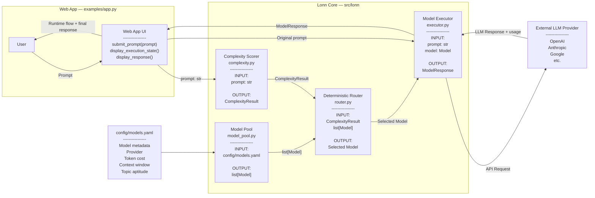
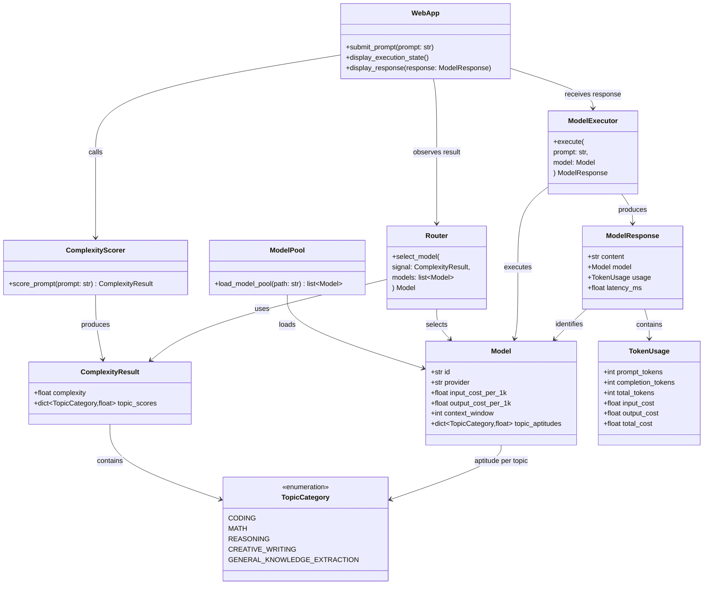
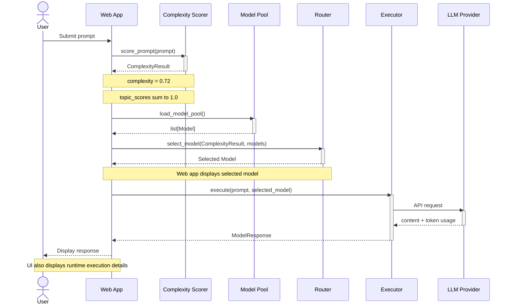
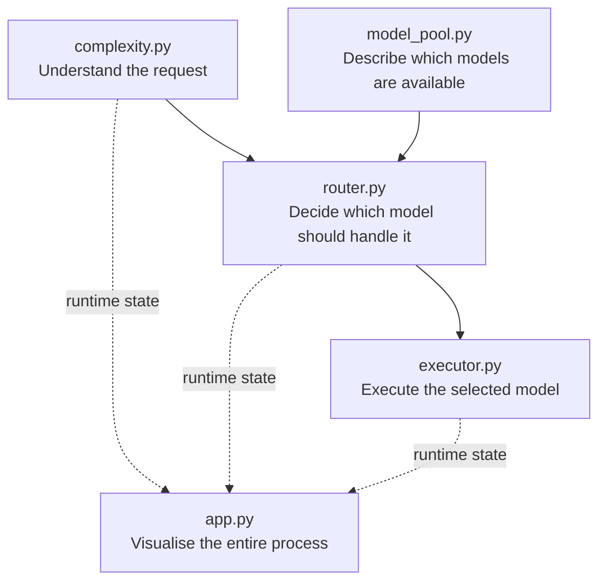

# Lonn Prototype Architecture

The Lonn prototype consists of four core responsibilities:

1. Analyse the incoming prompt.
2. Produce a complexity score and topic probability distribution.
3. Deterministically select the most suitable model.
4. Execute the request and return the result to the web application.

---

# 1. System Architecture



---

# 2. Core Classes and Data Contracts



---

# 3. Data Structures

## Complexity Result

The complexity scorer produces two different types of information.

### Overall complexity

```text
complexity ∈ [0, 1]
```

Example:

```python
complexity = 0.72
```

### Topic distribution

`topic_scores` represents a probability distribution over the supported
categories.

Therefore:

```text
Σ topic_scores = 1.0
```

Example:

```python
topic_scores = {
    "coding": 0.35,
    "math": 0.05,
    "reasoning": 0.40,
    "creative_writing": 0.08,
    "general_knowledge_extraction": 0.12,
}
```

The values sum to:

```text
0.35 + 0.05 + 0.40 + 0.08 + 0.12 = 1.00
```

---

# 4. Model Configuration

Model topic values are **aptitude scores**, not probability distributions.

Each aptitude is independently defined between:

```text
0.0 <= aptitude <= 1.0
```

They therefore do **not** have to sum to 1.

Example `config/models.yaml`:

```yaml
models:

  - id: gpt-5-mini
    provider: openai

    input_cost_per_1k: 0.00025
    output_cost_per_1k: 0.002

    context_window: 128000

    topic_aptitudes:
      coding: 0.80
      math: 0.40
      reasoning: 0.60
      creative_writing: 0.30
      general_knowledge_extraction: 0.70


  - id: example-reasoning-model
    provider: example-provider

    input_cost_per_1k: 0.001
    output_cost_per_1k: 0.004

    context_window: 200000

    topic_aptitudes:
      coding: 0.75
      math: 0.95
      reasoning: 0.95
      creative_writing: 0.40
      general_knowledge_extraction: 0.65
```

---

# 5. Runtime Execution Flow



---

# 6. Runtime Web App

The prototype web app should expose the internal routing process rather than
only showing the final LLM response.

A request should visually progress through:



```mermaid
flowchart LR

    A["1. Prompt Received"]

    B["2. Complexity Analysis"]

    C["3. Topic Distribution"]

    D["4. Model Routing"]

    E["5. Model Selected"]

    F["6. Model Execution"]

    G["7. Response Received"]

    H["8. Usage & Cost"]

    I["9. Final Response"]


    A --> B
    B --> C
    C --> D
    D --> E
    E --> F
    F --> G
    G --> H
    H --> I
```

The web app can therefore display information such as:

- Prompt token count
- Complexity score
- Topic probability distribution
- Candidate models
- Selected model
- Model topic aptitudes
- Context window
- Input token price
- Output token price
- Execution latency
- Input tokens
- Output tokens
- Total request cost
- Final model response

---

# 7. Responsibility Boundaries



The modules should remain independent:

- `complexity.py` does not know how routing works.
- `router.py` does not call model APIs.
- `model_pool.py` does not make routing decisions.
- `executor.py` does not determine which model is best.
- `app.py` orchestrates the prototype and visualises what happens at runtime.