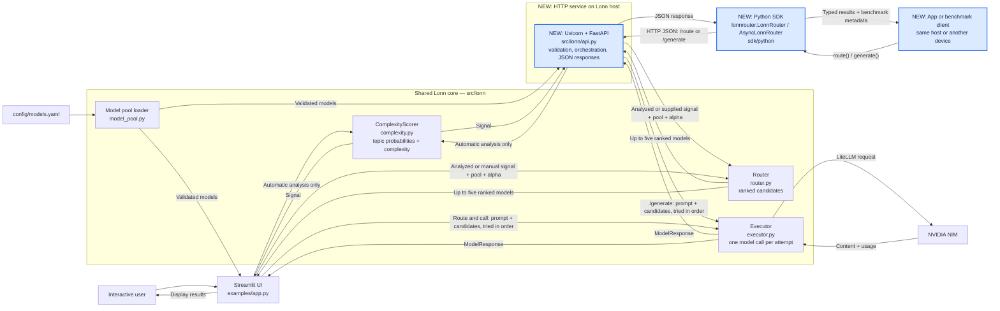
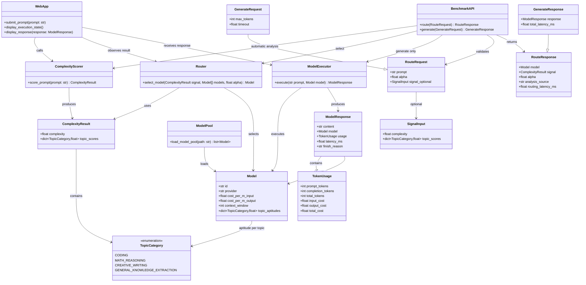
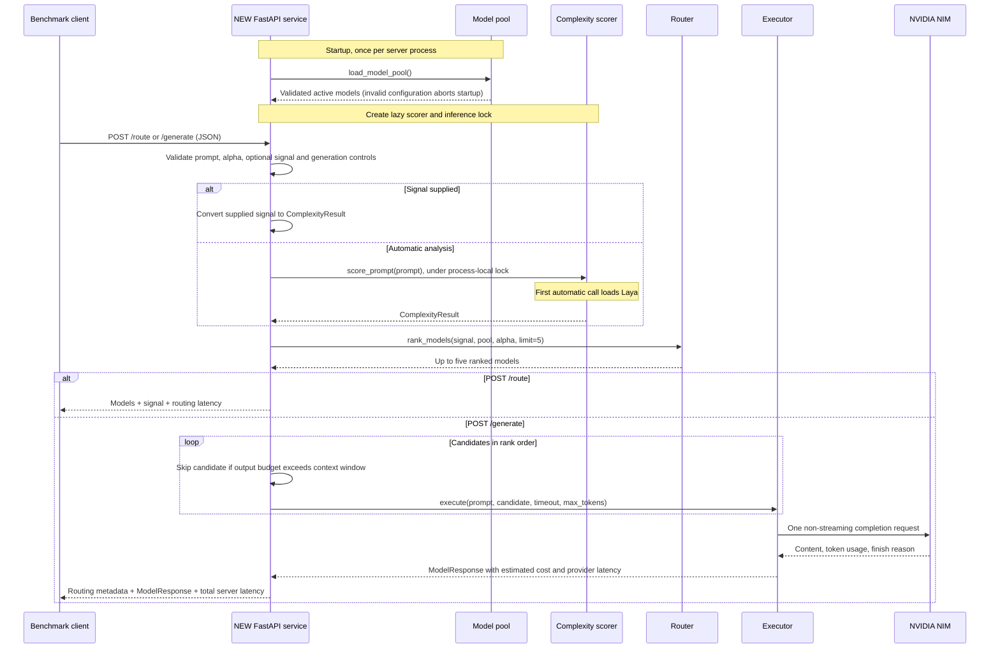
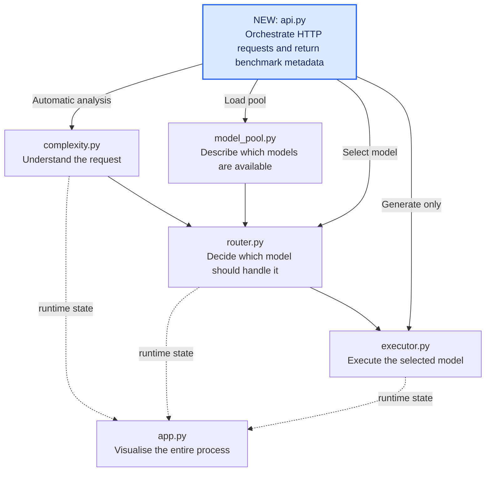

# Lonn Prototype Architecture

The Lonn prototype consists of four core responsibilities:

1. Analyse the incoming prompt.
2. Produce a complexity score and topic probability distribution.
3. Deterministically select the most suitable model.
4. Execute the request and return the result to the Streamlit UI or an HTTP benchmark client.

---

## Changes on `prototype3.0` (issue #19)

The app and the API route with the **task-type pipeline**. The sections further down describe the original pipeline (Laya topics, complexity and alpha), which remains in the code (`complexity.py`, `router.py`) but is no longer orchestrated.

```text
prompt → task_classifier.py (TaskSignal) → task_router.py (+ routing table, pool) → ranked models → executor.py
```

| Area | Original pipeline | `prototype3.0` |
| --- | --- | --- |
| Prompt analysis | Laya: 4 topics plus a complexity score | `TaskClassifier`: a frozen `BAAI/bge-small-en-v1.5` embedder plus a trained linear layer (`config/task_classifier.json`) gives a probability over 15 task types (`config/task_types.yaml`). Complexity is optional and off by default |
| Shared contract | `ComplexityResult(complexity, topic_scores)` | `TaskSignal(task_scores, complexity=None)` in `schemas.py` |
| Model quality | Static per-topic aptitudes in `models.yaml` | Accuracy measured per task type on the benchmark (`config/routing_table.json`, `routing_table.py`) |
| Model cost | List price, normalized by the pool maximum | Mean billed cost per request, including reasoning tokens |
| Selection | Maximum of `alpha·complexity·quality − (1−alpha)·cost` | Maximum of `accuracy − lam·cost_usd`, mixing task-type rows by probability (`task_router.py`, default `lam` 20) |
| HTTP request | `alpha`, optional `signal {complexity, topic_scores}` | `lam`, optional `signal {task_scores, complexity?}` |
| HTTP response | `models`, `signal`, `alpha`, `analysis_source: laya/provided` | adds `estimates` (expected accuracy and cost per candidate); `lam`; `analysis_source: classifier/provided` |
| SDK | `lonnrouter` 0.1.0 | `lonnrouter` 0.2.0: `lam` instead of `alpha`, new `Signal`, `CandidateEstimate` |

Module boundaries are unchanged:
- the classifier knows nothing about routing;
- the router and the routing table make no API calls;
- only the app and the API orchestrate.

Design, evaluation and limits are in `docs/task_types.md`, `docs/task_router.md`, `docs/task_data.md` and `docs/classifier_bakeoff.md`.

---

## Changes on `12-fastapi-layer`

The **NEW** labels and blue nodes below highlight the FastAPI work in this
branch's working tree relative to its starting commit `e128f50`. These changes
have not yet been committed at the time of this documentation update.

| Area | Before FastAPI | New in this branch's working tree |
| --- | --- | --- |
| Entry points | Streamlit UI and direct Python calls | `src/lonn/api.py`: HTTP access through Uvicorn/FastAPI |
| App integration | Hand-written HTTP calls | Installable `lonnrouter` Python SDK, sync and async clients, typed results and exceptions |
| Routing benchmark | Call `select_model` from Python | `POST /route`: automatic analysis or a supplied signal |
| End-to-end benchmark | Execute through Python or Streamlit | `POST /generate`: selection, response, usage, costs, and timings |
| Service inspection | Local configuration | `GET /health`, `GET /models`, `/docs`, `/openapi.json` |
| HTTP contracts | None | Pydantic input validation, typed responses, sanitized HTTP errors |
| Service lifecycle | UI-managed scorer | Pool loaded at startup; lazy scorer and inference lock per API process |
| Dependencies | Existing core and UI dependencies | FastAPI, Pydantic, Uvicorn, and HTTPX explicitly listed |
| Verification | Core and UI tests | Nine API tests and ten SDK tests; existing fake Laya fixed to answer combined questions |
| Documentation | Local UI/Python usage | API examples, benchmark timing semantics, and remote access instructions |

The broader branch comparison against the locally available `origin/main`
(`f1ade59`) also includes the earlier curated model pool, Streamlit app, discovery
and probe scripts, combined Laya analysis, and executor truncation metadata from
`924d7a8`, plus ignore-file changes from `e128f50`. Those are existing foundations,
not additions made by the FastAPI layer. The routing formula and NVIDIA executor
are reused by both entry points.

# 1. System Architecture



The arrows show calls and returned data. The UI and API each orchestrate the
shared core directly. Streamlit does not call the new HTTP service. `/route`
stops after selection; `/generate` proceeds to the executor. Supplying `signal`
bypasses the scorer. The API model pool is held in memory after startup.
The SDK runs in the calling app and needs only HTTPX and Pydantic. It serializes
requests, parses typed results, and translates HTTP/transport failures into
SDK exceptions. Direct HTTP callers can use the same endpoints without it.

---

# 2. Core Classes and Data Contracts



---

# 3. Data Structures

## Complexity Result

The complexity scorer produces two different types of information.

### Overall complexity

```text
complexity ∈ [0, 1]
```

Example:

```python
complexity = 0.72
```

### Topic distribution

`topic_scores` represents a probability distribution over the supported
categories.

Therefore:

```text
Σ topic_scores = 1.0
```

Example:

```python
topic_scores = {
    "coding": 0.35,
    "math_reasoning": 0.45,
    "creative_writing": 0.08,
    "general_knowledge_extraction": 0.12,
}
```

The values sum to:

```text
0.35 + 0.45 + 0.08 + 0.12 = 1.00
```

---

# 4. Model Configuration

Model topic values are **aptitude scores**, not probability distributions.

Each aptitude is independently defined between:

```text
0.0 <= aptitude <= 1.0
```

They therefore do **not** have to sum to 1.

The single model configuration is `config/models.yaml`. It contains a YAML
list with the same field names as `Model`: `id`, `provider`,
`cost_per_m_input`, `cost_per_m_output`, `context_window`, and `topic_aptitudes`.
Full LiteLLM IDs use `<provider>/<publisher>/<model>`, where `provider` is
`nvidia_nim` or `openrouter` and must match the entry's `provider` field.
OpenRouter is used only as a credit-based way to reach models; its own routing
is not used.

Additional configuration fields are `active`, `price_basis`, and
`matched_provider_key` (the source of a third-party price estimate). The loader
filters inactive entries and validates the shared contract. Pricing references
are metadata and must never replace the execution ID.

Discovery (`scripts/discover_models.py`) saves every catalog ID
without requiring pricing or guessing chat support from names. Availability
probing (`scripts/check_models.py`) separately checks text generation, records
timestamps and attempt outcomes, and never mutates routing configuration.
Timeouts and rate limits are transient failures; tool capability is separate.
A catalog listing is not a successful inference check. Generated JSON reports
are written to the ignored `reports/` directory and are not model configuration.

`load_model_pool(path)` validates all active entries and returns `list[Model]`.
It rejects duplicate IDs, unknown context limits, incomplete aptitude maps,
invalid prices, and missing price provenance (`price_basis`). It never invents
aptitudes or treats missing metadata as zero. A pool with no active models fails
explicitly. Configuration may retain inactive incomplete candidates.

The pool contains documented context values and benchmark-derived aptitude
proxies. Sources, raw results, normalization, and deployment limitations are
recorded in [model_metadata.md](model_metadata.md). These are initial routing
estimates, not measured performance of our hosted requests. Prices sourced
from other providers remain prototype cost estimates, not NVIDIA billing rates.

---

# 5. Runtime Execution Flow — NEW HTTP path



This diagram shows the successful paths. Validation failures return 422;
analysis/routing failures 503; provider rate limits 429; provider timeouts 504;
other execution failures 502. Raw provider exceptions are not returned to clients.
The API retries with the next ranked model after a failed provider attempt,
up to five candidates. The executor still makes one provider call per attempt.

---

# 6. Runtime Web App

The local Streamlit app in `examples/app.py` exposes the internal routing process rather than
only showing the final LLM response.

Run with `python3 -m streamlit run examples/app.py --server.address localhost`.
Automatic mode uses Laya; manual mode supplies an explicit topic/complexity for
isolated routing and API tests. Analyze-only mode makes no NVIDIA request.
Submitting a live request invokes scorer → router → executor; changing controls
does not resend it. Results and provider-error categories are shown in the UI.

A request progresses through:

```mermaid
flowchart LR

    A["1. Prompt Received"]

    B["2. Complexity Analysis"]

    C["3. Topic Distribution"]

    D["4. Model Routing"]

    E["5. Model Selected"]

    F["6. Model Execution"]

    G["7. Response Received"]

    H["8. Usage & Cost"]

    I["9. Final Response"]


    A --> B
    B --> C
    C --> D
    D --> E
    E --> F
    F --> G
    G --> H
    H --> I
```



The web app can therefore display information such as:

- Prompt token count
- Complexity score
- Topic probability distribution
- Candidate models
- Selected model
- Model topic aptitudes
- Context window
- Input token price
- Output token price
- Execution latency
- Input tokens
- Output tokens
- Total request cost
- Final model response

---

# 7. Responsibility Boundaries

## Prototype routing policy

`router.rank_models(signal, models, alpha=0.5, limit=5)` (also available as
`Router().rank_models(...)`) returns up to five models in score order.
`select_model(...)` remains a compatibility helper for callers that need only
the first ranked model.

1. Compute quality as `sum(topic_probability * model_topic_aptitude)`.
   Missing aptitudes count as zero.
2. Add `cost_per_m_input` and `cost_per_m_output`, both prices per million
   tokens in the same currency. This is an equal-token price proxy, not an
   actual request cost estimate.
3. Normalize cost by dividing by the highest combined price in the pool.
   When all models are free, every normalized cost is zero.
4. Maximize `alpha * complexity * quality - (1 - alpha) * normalized_cost`.
5. Break score ties by lower price, higher quality, then `(provider, id)`.

`weighted_score(quality, cost, alpha=0.5)` exposes the weighted function.
All three arguments must be finite and in [0, 1]. Alpha 0 prioritizes cost;
alpha 1 prioritizes quality. The default is 0.5. Pool-relative normalization
puts cost on the same [0, 1] scale as quality, but adding/removing models can
change the tradeoff. Raw price units do not affect selection. Complexity scales
the quality contribution automatically: at 0, cost determines the primary
score; at 1, routing follows the full `alpha` quality/cost tradeoff. `alpha`
remains the caller's preference for the most complex prompts. Complexity is a
heuristic difficulty signal, and the current topic aptitudes are not calibrated
by difficulty, so evaluate this policy against application-specific prompts.
Context-window filtering still requires prompt tokens and an output budget.

An empty pool, duplicate `(provider, id)` entries, invalid probabilities,
aptitudes, complexity, alpha, or prices raise `ValueError`. Probabilities must
sum to one within an absolute tolerance of `1e-6`.

Run the router tests with `python3 tests/test_router.py` or
`python3 -m unittest discover -s tests` from the repository root.

## Executor policy and shared contracts

`schemas.py` owns the shared dataclasses: `ComplexityResult`, `Model`,
`TokenUsage`, and `ModelResponse`. A dataclass supplies generated initialization,
representation, and equality methods; it does not validate field types itself.
The router and executor consume these contracts, and the app displays them.

`executor.execute(prompt, model, timeout=120, max_tokens=4096)` and
`ModelExecutor().execute(...)` send a non-streaming text request using LiteLLM's
NVIDIA NIM or OpenRouter provider, chosen by the model's `provider`. The
executor loads the repository `.env` without overriding existing environment
values and requires only the key for that provider: `NVIDIA_NIM_API_KEY` or
`OPENROUTER_API_KEY`.

The result contains text, the selected model, measured request latency in
milliseconds, token counts, estimated costs, and `finish_reason`. Cost is
`tokens / 1_000_000 * configured_price` for input and output separately.
A `length` finish reason allows the app to identify a truncated response.

Invalid inputs, missing credentials, missing usage, or non-text responses fail
explicitly. Provider exceptions propagate to the caller. The executor performs
no rerouting, automatic retries, streaming, or tool execution. Its output budget
must be below the context window; full prompt-plus-output context validation
remains a future task requiring model-specific token counting.

Dependencies are listed in `requirements.txt`; executor tests use mocked calls.



The modules should remain independent:

- `complexity.py` does not know how routing works.
- `router.py` does not call model APIs.
- `model_pool.py` does not make routing decisions.
- `executor.py` does not determine which model is best.
- `app.py` orchestrates the prototype and visualises what happens at runtime.
- **NEW:** `api.py` orchestrates HTTP requests and returns benchmark metadata.


# 8. Benchmark HTTP contract — NEW

| Endpoint | Input | Output / effect |
| --- | --- | --- |
| `GET /health` | None | `{"status":"ok"}`; no classifier/provider readiness probe |
| `GET /models` | None | Active models with context windows, topic aptitudes and configured prices |
| `POST /route` | `prompt`, optional `alpha` and `signal` | Ranked `models` list, signal, alpha, analysis source, routing latency; no provider call |
| `POST /generate` | Routing input plus optional `max_tokens` and `timeout` | Successful model, route metadata, `response` (`ModelResponse`) and total latency |
| `GET /docs` | None | Interactive API documentation |
| `GET /openapi.json` | None | Machine-readable request/response schema |

`prompt` is nonblank and preserved verbatim. `alpha` defaults to 0.5 and must be
finite in [0, 1]. Optional `signal` contains `complexity` and `topic_scores`;
probabilities must sum to 1 within 1e-6, and omitted categories count as zero.
Extra request fields are rejected. `analysis_source` is `laya` or `provided`.
The API uses the core dataclasses for response data, with Pydantic models for
HTTP validation and serialization.

`max_tokens` is a positive integer (default 4096) and must fit at least one of
the ranked candidates' context windows. `timeout` is a positive number of seconds up to 600 (default
120), passed to the provider call. It is not an overall HTTP or classifier
deadline. Full prompt-plus-output token validation is not implemented.

| Timing field | Measured work |
| --- | --- |
| `routing_latency_ms` | Analysis and selection, including classifier lock wait and first-use loading |
| `response.latency_ms` | The executor's provider completion call |
| `total_latency_ms` | Server handler work for routing and execution, excluding HTTP transport and response serialization |

Measure elapsed time in the benchmark client for network-inclusive latency.
Warm up with an automatic `/route` request before steady-state measurements.
The classifier lock serializes automatic analysis within each process; provider
calls can overlap in FastAPI's worker threads. Each Uvicorn process owns its own
pool, scorer, and lock. Restart to reload the model configuration.

The `response.usage` object contains prompt/completion/total tokens and estimated
input/output/total cost. Record `response.finish_reason`: `length` can mean the
budget was consumed by reasoning before a final answer. `/route` has no token
usage or execution cost because it makes no provider request.

`api.py` owns HTTP orchestration, lifecycle, validation and error translation.
It does not change the routing policy or executor. This interface currently
accepts single text prompts; it does not implement OpenAI chat completions,
streaming, tool calls, authentication, or server-side batch jobs.

# 9. Calling from another device — NEW

Python apps should install the [SDK](../sdk/python/README.md) and configure
`LonnRouter(base_url="http://HOST_IP:8000")` once, then call `route(...)` or
`generate(...)`. `AsyncLonnRouter` provides matching async methods. `LONN_BASE_URL`
can supply the address instead. The network setup below applies equally to SDK
and direct HTTP calls; installation alone does not deploy or start the server.

For a benchmark client on the same trusted LAN, start the server from the Lonn
repository on the host machine:

```bash
source .venv/bin/activate
python3 -m uvicorn lonn.api:app --app-dir src --host 0.0.0.0 --port 8000
```

`0.0.0.0` binds all IPv4 interfaces, making the application available on the local
network ([Uvicorn settings](https://www.uvicorn.org/settings/)). Clients use the
host's LAN IP, not `0.0.0.0` or their own `localhost`. Find the host's IP in its
network settings. On macOS, `ipconfig getifaddr en0` works when `en0` is the
active interface; otherwise use the interface shown by `networksetup -listallhardwareports`.

On the other device, replace `192.168.1.42` below with that host IP:

```bash
curl http://192.168.1.42:8000/health
curl http://192.168.1.42:8000/route \
  -H 'Content-Type: application/json' \
  -d '{"prompt":"Write a sorting function","alpha":0.7,"signal":{"complexity":0.5,"topic_scores":{"coding":1.0}}}'
```

The supplied signal makes this a connectivity and routing check without loading
Laya or calling NVIDIA. Omit `signal` for automatic analysis. Use `/generate`
for an actual response and optionally supply `max_tokens` and `timeout`.
The NVIDIA key stays on the server in its environment or repository `.env`;
clients do not send that key. API docs are at `http://HOST_IP:8000/docs`.

If connecting fails, confirm the server is running, allow inbound TCP port 8000
in the host firewall for the benchmark device, and check that Wi-Fi client
isolation or guest-network rules are not blocking peer access. A Python or curl
client does not need CORS; a browser app served from another origin would need
an explicit CORS policy, which this API does not currently configure.

The service has no authentication or TLS. Every device that can reach it can
call `/generate` using the server's NVIDIA account, so use direct HTTP only on a
trusted network and do not port-forward it publicly. For access from outside
that network, use an existing private VPN or an SSH tunnel. With SSH access to
the host, keep Uvicorn bound to `127.0.0.1` and run on the client:

```bash
ssh -N -L 8001:127.0.0.1:8000 USER@HOST
```

Then call `http://127.0.0.1:8001/route` or `/generate` from that client. SSH must
already be reachable and enabled on the host. A LAN IP alone is not reachable
from the public internet.
